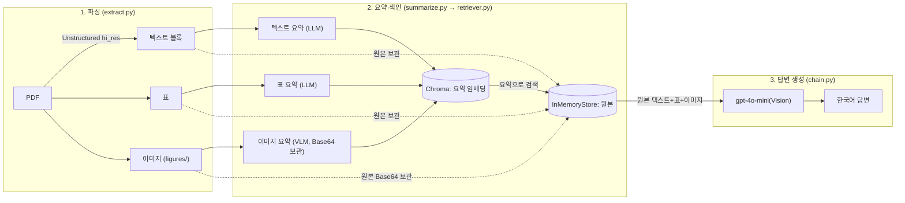

# Multimodal RAG

## 문제 정의

[질병관리청 「손상예방」 2023 No.3](https://www.kdca.go.kr/injury) 중 "직업손상" 특집 기사(6~20페이지,
`data/invest.pdf`)를 대상으로 한다. 이 자료는 본문 텍스트 사이사이에 **성별·연령대·산업별·사망원인별
손상 현황표가 7개 이상**, 그리고 **연도별 추이를 보여주는 꺾은선·막대 그래프**가 섞여 있다. 일반적인
텍스트 전용 RAG는 표의 수치를 "줄글로 뭉개서" 검색하거나, 그래프 이미지를 아예 버리기 때문에 "그래프에
나타난 추이가 어떤가요?" 같은 질문에는 본문의 두루뭉술한 서술("다소 감소하는 추세")만 반환하고 실제
수치(연도별 사망자 수·사망률)는 답하지 못한다. 이 프로젝트는 텍스트·표·이미지를 각각의 형식에 맞게
추출·요약·색인하여, 표/그래프에만 존재하는 수치까지 근거로 답변할 수 있는 RAG를 구축하는 것이 목표다.

## 아키텍처



**왜 요약으로 검색하고 원본으로 답하는가?** 임베딩 모델은 긴 원문이나 이미지 자체를 직접 비교하기
어렵다. 그래서 검색엔 "검색에 최적화된 짧은 요약"을 임베딩하고, 같은 ID로 묶어둔 **원본**(페이지
텍스트, 표의 HTML/텍스트, 이미지의 Base64)을 docstore에서 꺼내 LLM에 넘긴다. 요약만 넘기면 숫자나
세부 정보가 날아가므로, 답변 생성에는 반드시 원본을 쓴다.

## 프로젝트 구조

```text
MultimodalRag/
├── .venv/                       # 로컬 가상환경 (Git 제외)
├── .env                         # API 키 (Git 제외)
├── .env.example                 # 환경 변수 템플릿
├── .gitignore
├── requirements.txt              # 직접 의존성 목록
├── requirements.lock.txt         # pip freeze 전체 고정
├── README.md
├── data/
│   ├── invest.pdf                # 과제용 원본 PDF 발췌본 (Git 제외)
│   └── figures/                  # 추출된 이미지 (Git 제외)
├── notebooks/
│   └── Multi_modal_RAG.ipynb     # 실행 노트북 (결과 포함)
└── src/
    ├── __init__.py
    ├── extract.py                 # PDF → 텍스트/표/이미지 추출 (Unstructured hi_res)
    ├── summarize.py               # 텍스트·표 LLM 요약 + 이미지 VLM 요약
    ├── retriever.py                # 다중 벡터 검색기 (요약 검색 → 원본 반환)
    └── chain.py                    # 검색 결과로 최종 답변 생성 (멀티모달 LLM)
```

## 시작하기

Python 3.11을 준비한 뒤 프로젝트 루트에서 실행한다. `hi_res` 파싱과 한국어 OCR을 위해
**Poppler**와 **Tesseract(`kor` 언어팩 포함)**가 OS에 설치되어 있어야 한다(PATH 등록 필요).

```powershell
python -m venv .venv
.\.venv\Scripts\Activate.ps1
python -m pip install --upgrade pip
pip install -r requirements.txt
Copy-Item .env.example .env

# Jupyter에서 이 가상환경을 커널로 쓰려면
python -m ipykernel install --user --name multimodal-rag --display-name "Python (multimodal-rag .venv)"
```

`.env`의 `OPENAI_API_KEY`에 키를 입력한다. `.env`, `data/figures/`, `*.pdf`는 Git에 포함되지 않는다.
VS Code에서 `notebooks/Multi_modal_RAG.ipynb`를 열 때는 우측 상단 커널을
**"Python (multimodal-rag .venv)"**로 선택해야 `unstructured` 등 의존성을 인식한다.

## 빠른 사용

```python
from pathlib import Path

from src.chain import build_answer_chain
from src.extract import extract_pdf
from src.retriever import create_multi_vector_retriever
from src.summarize import summarize_documents, summarize_images

texts, tables, image_paths = extract_pdf(Path("data/invest.pdf"))
text_summaries = summarize_documents(texts)
table_summaries = summarize_documents(tables)
image_originals, image_summaries = summarize_images(image_paths)

retriever = create_multi_vector_retriever(
    texts + tables + image_originals,
    text_summaries + table_summaries + image_summaries,
)
chain = build_answer_chain(retriever)
print(chain.invoke("그래프에 나타난 손상 발생 추이는 어떤 경향을 보이나요?"))
```

벡터 인덱스(Chroma)와 원본 저장소(InMemoryStore)는 메모리 기반이므로, 프로세스를 다시 시작하면
추출·요약·색인을 다시 실행해야 한다.

전체 실행 과정과 결과는 `notebooks/Multi_modal_RAG.ipynb`에 있다.

## 기술 선택 근거

| 선택 | 이유 |
| --- | --- |
| `unstructured` `hi_res` 전략 | 레이아웃 분석 모델 없이는 표가 구조 없이 텍스트로 뭉개지고, 그래프 이미지도 추출되지 않는다. 이 자료는 표/그래프 비중이 커서 `hi_res`가 필수였다. |
| `gpt-4o-mini` (텍스트 요약 + VLM 모두) | 교재 기준 모델(`gpt-4-vision-preview`)은 지원 종료됨. `gpt-4o-mini`는 비전 입력을 지원하면서 비용이 낮아 텍스트/이미지 요약을 같은 모델로 통일했다. |
| 요약을 한국어로 생성 | 원문이 한국어이고 질문도 한국어이므로, 검색 임베딩과 질의 언어를 맞춰 검색 정확도를 높였다. |
| `by_title` 청킹, `max_characters=4000` | 기사 단위(타이틀)로 블록을 나눠 문맥이 섞이지 않게 했다. |
| 검색기 `k=6` | 기본값(4)에서는 표/이미지 요약이 본문 텍스트 요약에 밀려 상위에 들지 못해, 그래프 질문에서도 이미지가 전혀 검색되지 않았다. `k=6`으로 늘려 실제로 이미지가 근거로 잡히는 것을 확인했다. |
| `langchain-classic` 추가 | `langchain` 1.x부터 `MultiVectorRetriever`가 `langchain-classic`으로 분리되어, 별도로 설치해야 했다. |

## Before / After 비교 — 텍스트 전용 RAG vs 멀티모달 RAG

질문: **"그래프에 나타난 손상 발생 추이는 어떤 경향을 보이나요?"**

| 구분 | 답변 |
| --- | --- |
| 텍스트 전용 RAG | 그래프에 나타난 손상 발생 추이는 다음과 같은 경향을 보입니다. 최근 들어 우리나라 전체 손상의 연도별 발생률, 입원율, 사망률이 다소 감소하는 경향이 있다는 점이 언급되었습니다. 그러나 업무상 사고로 인한 사망자는 감소하는 추세를 보이지만, 업무상 사고 재해자 수와 발생률은 증가하는 경향이 있는 것으로 나타났습니다. |
| 멀티모달 RAG | 그래프에 나타난 손상 발생 추이는 다음과 같은 경향을 보입니다. 전체 사망자 수는 2011년 1,129명에서 점점 줄어들어 2020년에는 882명으로 감소한 반면, 조 사망률은 7.9명에서 4.6명으로 지속적으로 감소하는 추세를 보였습니다. |

텍스트 전용 RAG는 본문 서술만으로 "다소 감소", "증가하는 경향" 같은 정성적 표현에 그치지만, 멀티모달
RAG는 차트 이미지를 직접 읽어 **연도·수치**(2011→2020년, 1,129명→882명, 7.9→4.6)까지 인용한다.
이 수치는 본문 어디에도 텍스트로 적혀 있지 않고 그래프 안에만 있다.

## 질의응답 5건

| 질문 | 답변 요약 | 근거가 된 원본 종류 |
| --- | --- | --- |
| 손상 사고를 당한 사람들의 성별 비율은 어떻게 되나요? | 남성 77.1%(71,218명), 여성 22.9%(21,165명) | 텍스트, **표** |
| 연령대별로 손상이 가장 많이 발생한 구간은 어디인가요? | 50-59세(29.0%) > 60-69세(21.9%) > 40-49세(18.3%) | 텍스트 |
| 산업별 손상 발생 현황에서 가장 두드러지는 산업은 무엇인가요? | 기타의 사업(39.0%) > 건설업(26.6%) > 제조업(25.0%) | 텍스트 |
| 그래프에 나타난 손상 발생 추이는 어떤 경향을 보이나요? | 사망자 수 1,129명(2011)→882명(2020), 조사망률 7.9→4.6으로 감소 | 텍스트, **이미지(차트)** |
| 직업손상과 관련한 국내외 법 제도에는 어떤 것들이 있나요? | 산업재해보상보험법(국내), ILO의 직업손상 정의(국제), 직업병 의심사례 보고 체계 | 텍스트 |

(질문/답변 전문과 각 질문의 검색 근거 6건 전체 목록은 `notebooks/Multi_modal_RAG.ipynb` 5번 셀 실행
결과에 있다.)

## 한계점

- `data/invest.pdf`는 80페이지 원본 중 표/그래프가 밀집한 6~20페이지만 발췌한 것이다. 전체 문서를
  대상으로 하려면 `hi_res` 파싱 시간과 요약 API 비용이 비례해서 늘어난다.
- 추출된 이미지 10장 중 실제 데이터 차트는 2장뿐이고 나머지는 저자 사진·서식·인포그래픽이다.
  이미지 요약 프롬프트가 차트와 사진을 구분하지 않아, 사진에도 "검색에 유용할 수 있음" 식의 요약이
  붙는다.
- 벡터 인덱스가 메모리 기반(Chroma 인메모리, `InMemoryStore`)이라 프로세스 종료 시 사라진다. 매 실행마다
  추출·요약·색인을 다시 수행한다.
- PDF 원본의 한글 폰트가 ToUnicode 매핑이 깨져 있어, `unstructured`의 OCR(Tesseract `kor`)에 의존한다.
  OCR 인식 오류가 있으면 요약/답변 품질에 영향을 줄 수 있다.

## 트러블슈팅

| 증상 | 원인 | 해결 |
| --- | --- | --- |
| `ModuleNotFoundError: unstructured_inference` | `unstructured[all-docs]`만으로는 `hi_res` 레이아웃 모델 의존성이 빠질 수 있음 | `pip install unstructured-inference` |
| `ModuleNotFoundError: langchain.retrievers` | `langchain` 1.x에서 `MultiVectorRetriever`가 분리됨 | `pip install langchain-classic`, import 경로를 `langchain_classic...`으로 변경 |
| 노트북에서 `unstructured: 미설치`로 나옴 | VS Code가 프로젝트 `.venv`가 아닌 다른 커널로 실행 중 | 우측 상단에서 "Python (multimodal-rag .venv)" 커널 선택 |
| `TesseractNotFoundError` / 한국어 OCR이 깨짐 | Tesseract Path 누락 또는 `kor.traineddata` 미설치 | Tesseract 설치 확인, `languages=["kor","eng"]` 지정 확인 |
| 표가 하나도 안 잡힘 | `strategy="hi_res"` 또는 `infer_table_structure=True` 누락 | `extract.py`의 `partition_pdf` 옵션 확인 |
